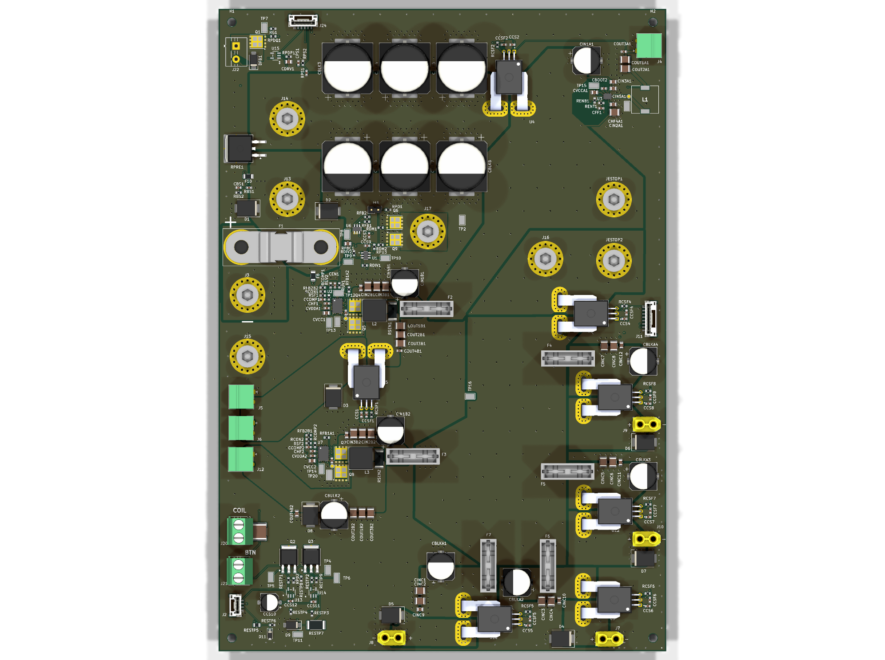
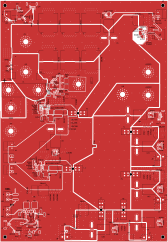
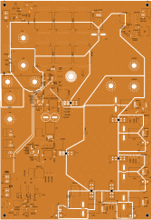
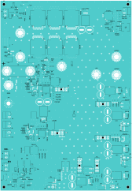
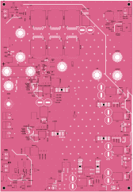
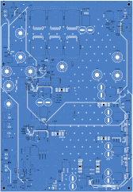

# Humanoid Robot Power Distribution Board


This repository contains the power distribution board (PDB) for the WiscoHumanoids humanoid robot. The board takes the 48 V battery, precharges the main bus, and distributes power to four high-current actuator branches. It also generates regulated 24 V, 6 V and 3.3 V rails for compute, hand servos, and sensors/control electronics.

**Status: Rev 1 has been fabricated and assembled by JLCPCB.**

## Rev 1 at a Glance

| | |
|---|---|
| Board size | 178.6 mm × 242.3 mm |
| Layers | 6 (FR-4 TG155, 1.6 mm) |
| Copper | 2 oz outer, 1 oz inner |
| Input | 48 V battery, 100 A main fuse |
| Current rating | 100 A at the battery input; about 65 A continuous with every output at full load (see [Current Ratings](#current-ratings)) |
| Outputs | 4 × 48 V actuator branches (XT30), 2 × 24 V, 1 × 6 V, 1 × 3.3 V |
| Current sensing | 7 × ACS758LCB-100B Hall-effect sensors (±100 A) |
| Assembly | 207 SMT/THT placements per board by JLCPCB (69 BOM lines); fuses and fuse holders installed by hand |

## Board Renders

| Isometric | Top |
|---|---|
|  |  |

## Copper Layers

Each layer is shown with the board outline and silkscreen so parts can be located on it.

| F.Cu (top) | In1.Cu |
|---|---|
|  |  |
| Components, signal routing, 48 V power pours, PGND | Solid PGND plane |

| In2.Cu | In3.Cu |
|---|---|
|  |  |
| 48 V power pours (paralleling the top layer), PGND | Solid PGND plane |

| In4.Cu | B.Cu (bottom) |
|---|---|
|  |  |
| PGND, signal routing | Signal routing, PGND |

The full schematic is in [`images/schematic.pdf`](images/schematic.pdf).

## System Power Architecture

```text
Battery + (J3)
   |
   F1  100 A main fuse
   |
   +-- RPRE1 precharge resistor ---+
   +-- Precharge contactor --------+   (off-board, J13 -> J14)
                                   |
                       48V_PRECH: 6 x 470 uF bulk (2.82 mF)
                                   |
                       U4  main current sensor
                                   |
                               48V_MAIN
   +-------------------------------+-------------------------------+
   |                               |                               |
   F2                         3.3 V buck (U3)            E-stop contactor (off-board,
   24 V buck (U2)                  |                     JESTOP1 -> JESTOP2)
   U5  24 V current sensor         J4  3.3 V out                   |
   |                                                           48V_ESTOP -- Brake chopper / regen dump
   J5  24 V -> Jetson                                              |         (dump resistor on J16/J17)
   J6  24 V -> USB-C PD controller                                 U8  actuator group current sensor
                                                                   |
                                                                48V_ACT
                     +--------------+--------------+--------------+--------------+
                     |              |              |              |              |
                     F7             F6             F5             F4             F3
                     U10            U9             U12            U11            6 V buck (U7)
                     J8  ACT1       J7  ACT2       J10 ACT3       J9  ACT4       J12  6 V -> hand servos
```

Compute and control (24 V, 3.3 V) is fed from `48V_MAIN`, ahead of the E-stop contactor. It stays powered when the E-stop opens, so the robot can still monitor, communicate and shut down safely. Everything that moves (the four actuator branches and the 6 V hand-servo rail) is fed from `48V_ACT`, after the E-stop contactor.

## Power Rails

| Rail | Generated by | Connector(s) | Purpose |
|---|---|---|---|
| 48 V | Battery, through F1 and precharge | J8, J7, J10, J9 (XT30) | Actuator branches ACT1–ACT4, each individually fused and current-sensed |
| 24 V | LM5148 synchronous buck controller (U2), 10 µH | J5, J6 (Phoenix MC 3.81 mm) | Jetson compute and USB-C PD controller |
| 6 V | LM5148 synchronous buck controller (U7), 4.7 µH | J12 (Phoenix MC 3.81 mm) | Servo motors in the robot hands (E-stop protected) |
| 3.3 V | LMR36015 buck regulator (U3), 18 µH | J4 (Phoenix MC 3.81 mm) | Sensors, current sensors, regen comparator, control logic |

## Current Ratings

These ratings come from the parts on the board. They have not been confirmed by a load or thermal test on Rev 1.

| Path | Rating | Set by |
|---|---|---|
| Battery input (48 V) | 100 A | F1 100 A main fuse; U4 measures up to ±100 A |
| Each actuator output (ACT1–ACT4) | 15 A continuous, 30 A for 1 minute | XT30 connector rating (the fuse holders accept blade fuses up to 30 A) |
| All four actuator outputs together | 60 A continuous | 4 × 15 A; U8 measures up to ±100 A |
| 24 V rail | About 8 A (190 W) | L2 inductor (8.7 A rated) and 8 A per output connector; the converter's current limit trips at about 15 A peak |
| 6 V rail | 8 A (48 W) | J12 connector rating; the converter's current limit trips at about 15 A peak |
| 3.3 V rail | 1.5 A | LMR36015 regulator |

With every output at full load the battery supplies about 65 A. The team currently expects the actuators to draw 15–20 A on average.

## Major Board Features

### 48 V Actuator Distribution

The main power path distributes 48 V battery power to four actuator branches. Each branch has its own blade fuse (F4–F7), current sensor and TVS diode, and leaves the board on an XT30 connector. Because this path carries the highest current on the board, the 48 V nets are poured on both the top layer and In2, with short current paths and bolt-down M5 connections for the battery and contactors.

### Precharge Circuit

The main bus carries 2.82 mF of bulk capacitance, so connecting the battery directly would cause a large inrush current. The precharge resistor RPRE1 sits permanently across an off-board precharge contactor (J13/J14), so the bus charges slowly through RPRE1 when the battery is connected. An external controller watches the battery and bus voltages, then closes the contactor (through an MCP1402 gate driver and Q1) to bypass the resistor.

Precharge connections are on **J24** (JST-GH 6-pin): `PRECH_EN`, `PRECH_SENSE`, `BATT_SENSE`, `24V_EN_IN`, 3.3 V and GND. The contactor coil connects to **J22**.

### E-Stop and Actuator Disconnect

An off-board E-stop contactor between JESTOP1 and JESTOP2 separates the actuator/servo group from the compute/control group. Its coil (**J20**) is powered through the normally-closed E-stop button (**J21**) and two series FETs (Q2/Q3), driven by MCP1402 gate drivers. The two enables and a feedback line are on **J2** (JST-GH 4-pin: `ESTOP_EN1`, `ESTOP_EN2`, `ESTOP_FB`, GND). Opening either the button or an enable drops the actuator group while compute stays up.

### Regen Protection (Brake Chopper)

When actuators decelerate they push energy back into the bus. If the battery can't take it (E-stop open, BMS charge FET open, or a full pack), the bus voltage rises. A TLV3011 comparator (U1) watches the actuator bus. When it crosses its trip point, a UCC27511 gate driver (U6) switches Q6/Q9 to dump the excess into an external chassis-mount resistor on **J16/J17**. Pulling jumper **J18** (`BC_Disconnect`) disables the chopper.

### Current Sensing

Seven ACS758LCB-100B bidirectional Hall-effect sensors monitor:

| Sensor | Path |
|---|---|
| U4 | Main battery input (after precharge) |
| U8 | Actuator group, after the E-stop contactor |
| U10, U9, U12, U11 | Actuator branches ACT1–ACT4 |
| U5 | 24 V rail output |

Each output is RC-filtered and brought out on **J11** (JST-GH 8-pin) for the robot's controller. Current measurement is used for detecting abnormal loads, debugging actuator behavior, estimating power use, and measuring regen.

### Protection

- 100 A main fuse (F1, bolt-down BF1, M5)
- Individually fused actuator branches (F4–F7), 24 V buck input (F2) and 6 V buck input (F3)
- 0.5 A fuses on the contactor coil supplies (F8, F10)
- SMC TVS diodes on the fused 48 V input, each actuator branch, and the 24 V and 6 V outputs
- Varistor across the E-stop contactor coil; flyback diode on the precharge contactor coil
- Precharge / inrush-current limiting
- Brake-chopper regen dump
- Separation between actuator/servo power and compute/control power

### Test Points

TP1–TP16 and TP20 are Keystone 5015 test points on PGND, the E-stop, precharge and regen-dump control signals, and the converter bias rails. TP17–TP19 are bare probe pads on the switch nodes of the 24 V, 6 V and 3.3 V converters.

## Grounding

The board uses one power ground plus local analog grounds:

| Net | Purpose |
|---|---|
| PGND | High-current power ground and switching converter return. Solid planes on In1, In3, In4, plus pours on the outer layers |
| AGND, AGND1–AGND10 | Local analog grounds for each buck converter's feedback network, each current sensor, and the regen comparator |

Each local AGND joins PGND at one point through a net tie (NT1–NT11). This keeps large return currents out of the feedback and measurement references.

## Simulations

LTspice simulations live in [`LTspice Simulations/`](LTspice%20Simulations/). Each folder has a `.lib` of behavioral models and the matching `.asy` symbols the schematics use.

| Simulation | Purpose |
|---|---|
| `precharge_sims/precharge_Rsweep.asc` | Sweeps the precharge resistor value to compare bus charge time against resistor and main-fuse stress |
| `precharge_sims/precharge_Loadsweep.asc` | Sweeps the load drawn during precharge to check the bus still reaches full voltage before the contactor closes |
| `Regen Protection/regen_2_as_drawn.asc` | The regen dump circuit exactly as drawn on the schematic, with injected actuator regen current. Checks peak bus voltage, dump resistor power, and TVS and FET stress |
| `Regen Protection/regen_3_fixed_Rsweep.asc` | The same circuit with candidate fixes (freewheel diode, local ceramic, sense filter, gate pulldown), sweeping the external dump resistor value |

Results are written to the SPICE output log as `.meas` values, including pass/fail checks.

## Repository Layout

| Path | Contents |
|---|---|
| `Main_PDB.kicad_pro` / `.kicad_sch` / `.kicad_pcb` | KiCad 10 project, schematic and board |
| `Main_PDB.kicad_dru` | Custom design rules (JLCPCB 6-layer, 2 oz outer copper limits, net-tie exceptions) |
| `Footprints.pretty/`, `Symbols/`, `3d Models/` | Project libraries and 3D models |
| `production/` | Rev 1 manufacturing outputs: gerbers (`PDB_PCB.zip`), BOM, pick-and-place, IPC netlist |
| `images/` | Board renders, layer SVGs and schematic PDF, regenerated from the design files (see [`images/regenerate-images.md`](images/regenerate-images.md)) |
| `LTspice Simulations/` | Precharge and regen protection simulations |

The images are rebuilt by a pre-commit hook whenever the board or schematic changes. Enable it once per clone with `git config core.hooksPath images/hooks`.
