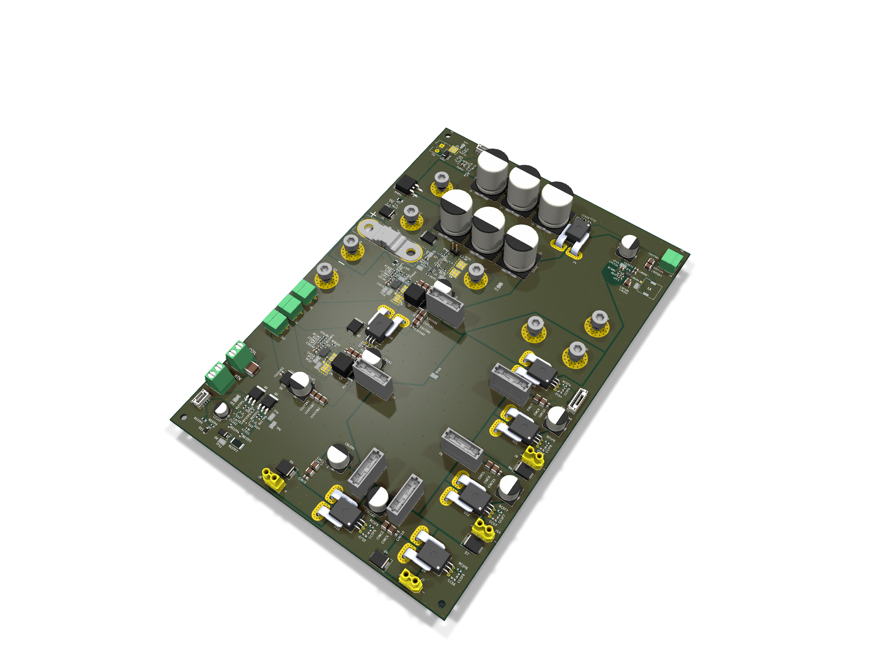
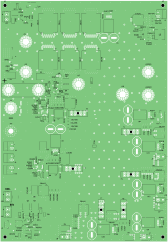

# WiscoHumanoids Power Distribution Board



This repository contains the power distribution board (PDB) for the WiscoHumanoids humanoid robot. The board takes the 48 V battery, precharges the main bus, and distributes power to four high-current actuator branches. It also generates regulated 24 V, 6 V and 3.3 V rails for compute, hand servos, and sensors/control electronics.

**Status: Rev 1 has been fabricated and assembled by JLCPCB.**

## Rev 1 at a Glance

| | |
|---|---|
| Board size | 178.6 mm × 242.3 mm |
| Layers | 6 (FR-4 TG155, 1.6 mm) |
| Copper | 2 oz outer, 1 oz inner |
| Input | 48 V battery, 70 A BF1 main fuse |
| Current rating | 70 A for a few minutes; actuators expected to draw about 10 A RMS, 21 A peak (see [Current Ratings](#current-ratings)) |
| Outputs | 4 × 48 V actuator branches (XT30), 2 × 24 V, 1 × 6 V, 1 × 3.3 V |
| Current sensing | 7 × ACS758LCB-100B Hall-effect sensors (±100 A) |
| Assembly | 207 SMT/THT placements per board by JLCPCB (69 BOM lines); fuses and fuse holders installed by hand |

## Board Renders

| Isometric | Top |
|---|---|
|  |  |

## Copper Layers

Each layer is shown with the board outline and silkscreen so parts can be located on it.

| L1 (top) | L2 |
|---|---|
|  |  |
| Components, signal routing, 48 V power pours, PGND | Solid PGND plane |

| L3 | L4 |
|---|---|
|  |  |
| 48 V power pours (paralleling L1), PGND, some signal routing | Solid PGND plane |

| L5 | L6 (bottom) |
|---|---|
|  |  |
| PGND, signal routing | Signal routing, PGND |

The full schematic is in [`images/schematic.pdf`](images/schematic.pdf).

## System Power Architecture

```text
Battery + (J3)
   |
   F1  70 A main fuse (BF1)
   |
   +-- RPRE1 precharge resistor ---+
   +-- Precharge contactor --------+   (off-board, J13 -> J14)
                                   |
                       48V_PRECH: 6 x 470 uF bulk (2.82 mF)
                                   |
                       U4  main current sensor
                                   |
                               48V_MAIN
   +-------------------------------+-------------------------------+
   |                               |                               |
   F2                         3.3 V buck (U3)            E-stop contactor (off-board,
   24 V buck (U2)                  |                     JESTOP1 -> JESTOP2)
   U5  24 V current sensor         J4  3.3 V out                   |
   |                                                           48V_ESTOP -- Brake chopper / regen dump
   J5  24 V -> Jetson                                              |         (dump resistor on J16/J17)
   J6  24 V -> USB-C PD controller                                 U8  actuator group current sensor
                                                                   |
                                                                48V_ACT
                     +--------------+--------------+--------------+--------------+
                     |              |              |              |              |
                     F7             F6             F5             F4             F3
                     U10            U9             U12            U11            6 V buck (U7)
                     J8  ACT1       J7  ACT2       J10 ACT3       J9  ACT4       J12  6 V -> hand servos
```

Compute and control (24 V, 3.3 V) is fed from `48V_MAIN`, ahead of the E-stop contactor. It stays powered when the E-stop opens, so the robot can still monitor, communicate and shut down safely. Everything that moves (the four actuator branches and the 6 V hand-servo rail) is fed from `48V_ACT`, after the E-stop contactor.

## Power Rails

| Rail | Generated by | Connector(s) | Purpose |
|---|---|---|---|
| 48 V | Battery, through F1 and precharge | J8, J7, J10, J9 (XT30) | Actuator branches ACT1–ACT4, each individually fused and current-sensed |
| 24 V | LM5148 synchronous buck controller (U2), 10 µH | J5, J6 (Phoenix MC 3.81 mm) | Jetson compute and USB-C PD controller |
| 6 V | LM5148 synchronous buck controller (U7), 4.7 µH | J12 (Phoenix MC 3.81 mm) | Servo motors in the robot hands (E-stop protected) |
| 3.3 V | LMR36015 buck regulator (U3), 18 µH | J4 (Phoenix MC 3.81 mm) | Sensors, current sensors, regen comparator, control logic |

## Current Ratings

| | Current |
|---|---|
| Board rating | 70 A for a few minutes (exact duration to be confirmed by a Rev 1 load test) |
| Main fuse (F1) | 70 A Littelfuse BF1, 142.5631.5702 (58 V, M5 bolt-down) |
| Expected actuator draw | About 10 A RMS walking at 1.0 m/s; peaks of about 21 A (100 ms) and 28 A (10 ms) |

These are design targets. Rev 1 has not been load or thermally tested yet.

**Why the rating is far above the expected load:** the board is deliberately oversized. Rev 1's power path was laid out before we had current numbers for the robot. Those came later, from a walking simulation of the actuators. It counts the motors only, with no regen, and has about ±25% uncertainty. The worst case was walking at 1.0 m/s: about 10 A RMS at the battery, with peaks of about 21 A over 100 ms and 28 A over 10 ms. We still want the board rated well above that, with room for roughly twice the actuator current for future expansion. That headroom covers the actuators only; the compute and servo rails draw current on top of it.

Each output also has a limit set by its parts:

| Output | Limit | Set by |
|---|---|---|
| Each actuator output (ACT1–ACT4) | 15 A continuous, 30 A for 1 minute | XT30 connector |
| 24 V rail | About 8 A (190 W) | 24 V buck inductor (8.7 A rated) and 8 A per output connector |
| 6 V rail | 8 A (48 W) | J12 connector |
| 3.3 V rail | 1.5 A | LMR36015 regulator |

## Signal Connectors

The PDB has three low-voltage signal connectors, all JST-GH (1.25 mm pitch). They use 3.3 V logic and are referenced to PGND. In the tables below, **In** and **Out** are from the PDB's point of view.

| Connector | Pins | Purpose |
|---|---|---|
| J11 | 8 | Analog current-sense outputs |
| J2 | 4 | E-stop logic: two enables in, contactor feedback out |
| J24 | 6 | Precharge board interface: precharge and 24 V enables in, battery and bus voltage sense out, 3.3 V supply out |

The contactor coil and E-stop button terminals (J20, J21, J22) run at battery voltage, not logic level. They are covered under [Precharge Circuit](#precharge-circuit) and [E-Stop and Actuator Disconnect](#e-stop-and-actuator-disconnect).

### J11: Current Sense Outputs (JST-GH 8-pin)

| Pin | Net | Dir | Measures |
|---|---|---|---|
| 1 | `Act_rail_curr` | Out | Actuator group, after the E-stop contactor (U8) |
| 2 | (unnamed) | Out | ACT1, J8 (U10) |
| 3 | (unnamed) | Out | ACT2, J7 (U9) |
| 4 | (unnamed) | Out | ACT3, J10 (U12) |
| 5 | (unnamed) | Out | ACT4, J9 (U11) |
| 6 | `Main_curr` | Out | Main battery input (U4) |
| 7 | `Com_cur` | Out | 24 V rail output (U5) |
| 8 | GND | | PGND |

- Each output comes from an ACS758LCB-100B powered from 3.3 V, through a 1 kΩ / 10 nF filter (about 16 kHz cutoff).
- The output is ratiometric to the 3.3 V supply. It reads 1.65 V at 0 A and changes by about 13.2 mV/A (the datasheet's 20 mV/A at 5 V, scaled to 3.3 V), so `I = (V − 1.65 V) / 0.0132 V/A`. ±100 A spans about 0.33–2.97 V.
- Current flowing toward the load reads above 1.65 V. Current flowing back toward the battery (regen) reads below 1.65 V.

### J2: E-Stop Logic (JST-GH 4-pin)

| Pin | Net | Dir | Function |
|---|---|---|---|
| 1 | GND | | PGND |
| 2 | `ESTOP_FB` | Out | E-stop contactor coil state: low = coil energized (actuators powered), high = coil off |
| 3 | `ESTOP_EN2` | In | Turns on coil switch Q3 (through gate driver U14) |
| 4 | `ESTOP_EN1` | In | Turns on coil switch Q2 (through gate driver U13) |

- **Enables:** active high, into MCP1402 gate drivers (high above 2.4 V, low below 0.8 V). The coil is energized only when both enables are high and the E-stop button is closed. Each enable has a 2.2 kΩ pull-down, so an unplugged connector or an unpowered controller leaves the contactor open. The controller has to source about 1.5 mA per enable at 3.3 V.
- **Feedback:** taken from the low side of the coil through a 100 kΩ / 7.5 kΩ divider and clamped by a 3.3 V zener (D11). With the coil off, the coil pulls this node up to battery voltage, so `ESTOP_FB` reads about 0.07 × battery voltage: about 3.3 V on a 48 V pack, and about 2.8 V at 40 V. With the coil energized it reads about 0 V. It reports the coil drive, not whether the contactor's contacts actually closed. It also reads low if the battery is disconnected or the coil fuse (F8) has blown.

### J24: Precharge Board Interface (JST-GH 6-pin)

| Pin | Net | Dir | Function |
|---|---|---|---|
| 1 | GND | | PGND |
| 2 | +3.3V | Out | 3.3 V supply for the precharge board (from U3) |
| 3 | `PRECH_EN` | In | Closes the precharge contactor, bypassing RPRE1 |
| 4 | `24V_EN_IN` | In | Turns on the 24 V buck (U2) for the Jetson and USB-C PD controller |
| 5 | `PRECH_SENSE` | Out | Bus voltage (`48V_PRECH`, after the precharge resistor), divided by 26.6 |
| 6 | `BATT_SENSE` | Out | Battery voltage (`48V_FUSE`, after F1), divided by 26.6 |

- **`PRECH_EN`:** active high, into an MCP1402 gate driver (U15) that drives Q1, the low-side switch for the contactor coil on J22. A 100 kΩ pull-down keeps the contactor open when nothing drives it.
- **`24V_EN_IN`:** active high. It reaches U2's EN/UVLO pin through a 100 kΩ / 100 kΩ divider, so a 3.3 V input puts 1.65 V on the pin. Left low or unconnected, the 24 V rail stays off. That keeps the Jetson and USB-C PD load off the precharge resistor until the precharge board turns the rail on.
- **Voltage sense:** 100 kΩ / 3.9 kΩ dividers (0.1%), so `V = V_pin × 26.64`. 48 V reads 1.80 V, and 3.3 V full scale is 87.9 V. Each has a 100 nF filter capacitor (about 3.75 kΩ source impedance, about 420 Hz cutoff).
- **3.3 V supply:** U3 runs from `48V_MAIN`, so the 3.3 V rail comes up while the bus is still charging through RPRE1. The precharge board can read both sense lines before it closes the contactor. This pin shares the 3.3 V rail's 1.5 A limit with the current sensors.

## Major Board Features

### 48 V Actuator Distribution

The main power path distributes 48 V battery power to four actuator branches. Each branch has its own 20 A ATO blade fuse (F4–F7), current sensor and TVS diode, and leaves the board on an XT30 connector. Because this path carries the highest current on the board, the 48 V nets are poured on both L1 and L3, with short current paths and bolt-down M5 connections for the battery and contactors.

### Precharge Circuit

The main bus carries 2.82 mF of bulk capacitance, so connecting the battery directly would cause a large inrush current. The precharge resistor RPRE1 sits permanently across an off-board precharge contactor (J13/J14), so the bus charges slowly through RPRE1 when the battery is connected. An external controller watches the battery and bus voltages, then closes the contactor (through an MCP1402 gate driver and Q1) to bypass the resistor.

The precharge board connects on **J24** (pinout in [Signal Connectors](#j24-precharge-board-interface-jst-gh-6-pin)). The contactor coil connects to **J22**.

### E-Stop and Actuator Disconnect

An off-board E-stop contactor between JESTOP1 and JESTOP2 separates the actuator/servo group from the compute/control group. Its coil (**J20**) is powered through the normally-closed E-stop button (**J21**) and two series FETs (Q2/Q3), driven by MCP1402 gate drivers. The two enables and a feedback line are on **J2** (pinout in [Signal Connectors](#j2-e-stop-logic-jst-gh-4-pin)). Opening either the button or an enable drops the actuator group while compute stays up.

### Regen Protection (Brake Chopper)

When actuators decelerate they push energy back into the bus. If the battery can't take it (E-stop open, BMS charge FET open, or a full pack), the bus voltage rises. A TLV3011 comparator (U1) watches the actuator bus. When it crosses its trip point, a UCC27511 gate driver (U6) switches Q6/Q9 to dump the excess into an external 1 Ω, 200 W chassis-mount resistor on **J16/J17**. Pulling jumper **J18** (`BC_Disconnect`) disables the chopper.

### Current Sensing

Seven ACS758LCB-100B bidirectional Hall-effect sensors monitor:

| Sensor | Path |
|---|---|
| U4 | Main battery input (after precharge) |
| U8 | Actuator group, after the E-stop contactor |
| U10, U9, U12, U11 | Actuator branches ACT1–ACT4 |
| U5 | 24 V rail output |

Each output is RC-filtered and brought out on **J11** for the robot's controller (pinout and scaling in [Signal Connectors](#j11-current-sense-outputs-jst-gh-8-pin)). Current measurement is used for detecting abnormal loads, debugging actuator behavior, estimating power use, and measuring regen.

### Protection

- 70 A main fuse (F1, Littelfuse BF1 142.5631.5702, M5 bolt-down)
- 20 A ATO blade fuses on each actuator branch (F4–F7), a 10 A fuse on the 24 V compute buck input (F2) and a 5 A fuse on the 6 V servo buck input (F3)
- 0.5 A fuses on the contactor coil supplies (F8, F10)
- SMC TVS diodes on the fused 48 V input, each actuator branch, and the 24 V and 6 V outputs
- Varistor across the E-stop contactor coil; flyback diode on the precharge contactor coil
- Precharge / inrush-current limiting
- Brake-chopper regen dump
- Separation between actuator/servo power and compute/control power

### Test Points

TP1–TP16 and TP20 are Keystone 5015 test points on PGND, the E-stop, precharge and regen-dump control signals, and the converter bias rails. TP17–TP19 are bare probe pads on the switch nodes of the 24 V, 6 V and 3.3 V converters.

### Off-Board Parts (Rev 1)

Rev 1 has these parts mounted off the board, bolted to its M5 pads:

| Part | Connects to | Rev 2 plan |
|---|---|---|
| Precharge contactor | J13 / J14 (coil on J22) | Replace with power FETs on the board |
| E-stop contactor | JESTOP1 / JESTOP2 (coil on J20) | Replace with power FETs on the board |
| 1 Ω, 200 W chassis-mount dump resistor | J16 / J17 | Find a smaller solution |
| Dump resistor freewheel diode (DFB2) | Across the dump resistor: cathode to J16, anode to J17 | Move onto the board |

## Grounding

The board uses one power ground plus local analog grounds:

| Net | Purpose |
|---|---|
| PGND | High-current power ground and switching converter return. Continuous reference planes on L2 and L4; on L1, L3, L5 and L6 it is poured around signal routing |
| AGND, AGND1–AGND10 | Local analog grounds for each buck converter's feedback network, each current sensor, and the regen comparator |

Each local AGND joins PGND at one point through a net tie (NT1–NT11). This keeps large return currents out of the feedback and measurement references.

## Simulations

LTspice simulations live in [`LTspice Simulations/`](LTspice%20Simulations/). Each folder has a `.lib` of behavioral models and the matching `.asy` symbols the schematics use.

| Simulation | Purpose |
|---|---|
| `precharge/precharge_resistor_sweep.asc` | Sweeps the precharge resistor value (the board uses 100 Ω) to compare bus charge time against resistor and main-fuse stress |
| `precharge/precharge_load_sweep.asc` | With the board's 100 Ω resistor, sweeps the load drawn during precharge to check the bus still reaches full voltage before the contactor closes |
| `regen/regen_earlier_design.asc` | An earlier version of the regen dump circuit, kept for reference. It is expected to fail its checks; the sim below shows the fixes |
| `regen/regen_current_sweep.asc` | The regen dump circuit with the fixes (freewheel diode, local ceramic, sense filter, gate pulldown), the board's resistor values and TVS diodes, and the 1 Ω dump resistor. Sweeps regen current from 10 to 50 A, held for 10 ms; 28 A is the worst 10 ms battery peak from the walking simulation. Checks the actuators stay under their 55 V maximum, the dump FET under 80 V, and the TVS diodes don't conduct |

Results are written to the SPICE output log as `.meas` values, including pass/fail checks.

## Repository Layout

| Path | Contents |
|---|---|
| `Main_PDB.kicad_pro` / `.kicad_sch` / `.kicad_pcb` | KiCad 10 project, schematic and board |
| `Main_PDB.kicad_dru` | Custom design rules (JLCPCB 6-layer, 2 oz outer copper limits, net-tie exceptions) |
| `Footprints.pretty/`, `Symbols/`, `3d Models/` | Project libraries and 3D models |
| `production/` | Rev 1 manufacturing outputs: gerbers (`PDB_PCB.zip`), BOM, pick-and-place, IPC netlist |
| `images/` | Board renders, layer SVGs and schematic PDF, regenerated from the design files (see [`images/regenerate-images.md`](images/regenerate-images.md)) |
| `LTspice Simulations/` | Precharge and regen protection simulations |

The images are rebuilt by a pre-commit hook whenever the board or schematic changes. Enable it once per clone with `git config core.hooksPath images/hooks`.
